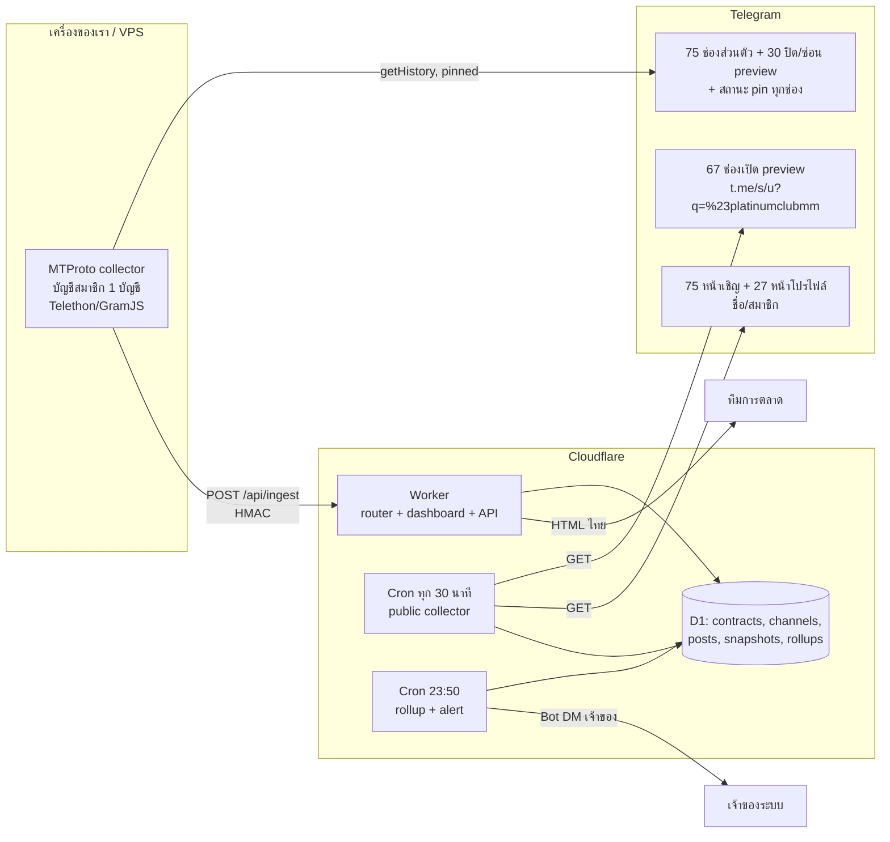

# SPEC — ระบบตรวจงานโพสต์ Telegram ของฝ่ายการตลาด (Platinum Club MM)

สถานะ: ฉบับที่ 1.1 · 25 ตุลาคม 2026 · เอกสารนี้เป็น **แหล่งอ้างอิงหลักฉบับเดียว** แทน `HANDOFF.md` และ `TELEGRAM_MARKETING_DASHBOARD_HANDOFF_TH.md` ในทุกจุดที่ขัดกัน (ไฟล์เดิมคงไว้เพื่ออ้างอิงประวัติ)

ตัวเลขทุกตัวในเอกสารนี้มาจาก `data/channels.seed.json`, `data/*.csv`, `data/data_quality.md` และ `data/probe_report.md` ซึ่งสร้างใหม่ได้ด้วยสคริปต์ใน `tools/` (ดู README) — ฉบับ 1.1 แก้ตัวเลขหลังรีวิวพบว่าตัวแยกชื่อหลายช่องและ hyperlink เก่าในเซลล์ทำให้นับคลาดเคลื่อน

---

## 1. สรุปสำหรับผู้ตัดสินใจ

- บริษัทจ่ายเงินให้ **เจ้าของช่อง Telegram** (ไม่ใช่ agency กลาง) ลงโฆษณาในช่องของตนทุกวัน เดือนตุลาคม 2026 มี **87 สัญญา** รวม **24,785,602 MMK** ครอบคลุมช่องจริง **172 ช่อง** (97 ช่องสาธารณะ + 75 ช่องส่วนตัวที่เข้าด้วยลิงก์เชิญ) **42 สัญญาคุมมากกว่า 1 ช่อง**
- ทีมตรวจด้วย Excel มือ: เปิดลิงก์ทีละช่อง นับโพสต์ พิมพ์ยอด subscriber/view และกด dropdown สถานะ ตัวชี้วัดที่ใช้ตัดสินต่อสัญญาจริงคือ **จำนวนผู้สมัครสมาชิก (Reg) ที่มาจากช่องนั้น** ไม่ใช่ยอดวิว
- ผลพิสูจน์ (probe 25 ต.ค. 2026): อ่านโพสต์จากภายนอกด้วยหน้า `t.me/s/<username>` ได้เพียง **67 จาก 172 ช่อง (39%)** คิดเป็นสัญญาที่ตรวจครบทุกช่องได้จากภายนอก **31 สัญญา (8.30M MMK จาก 24.79M)** ตามนิยามใน §3 ที่เหลือต้องมี **บัญชี Telegram ที่เป็นสมาชิก** จึงจะเห็นโพสต์ และเงื่อนไข **pin** (อยู่ใน 79 จาก 87 สัญญา) ตรวจจากหน้า preview ไม่ได้เลย
- **การตัดสินใจ (ผู้ใช้ยืนยัน 25 ต.ค. 2026): สถาปัตยกรรม Hybrid** — Cloudflare Worker ตรวจช่องที่เปิด preview + บัญชีสมาชิก 1 บัญชี (MTProto) ตรวจช่องส่วนตัว/ปิด preview และสถานะ pin ทั้งคู่เขียนลงฐานข้อมูลเดียว (ADR-001)
- ข่าวดี: **49 ช่องใช้ `#platinumclubmm` ในโพสต์อยู่แล้ว** และหน้าค้นหา `t.me/s/<u>?q=%23platinumclubmm` ใช้ได้ การบังคับแฮชแท็กจึงไม่ใช่ของใหม่สำหรับเจ้าของช่องส่วนใหญ่

## 2. บริบทธุรกิจที่อ่านได้จาก Excel

### 2.1 วงจรงานรายเดือน
1. ต้นเดือน copy ชีตเดือนก่อนเป็นชีตใหม่ (`October 2026 MKT Pla` → `Nov 2026 MKT Pla`) บวก streak ในคอลัมน์ `Continue TIme` (`33th time continue` → `34th`) และตั้ง Payment เป็น 0
2. จ่ายเงินผ่าน Kpay/Wave ให้ `Admin account` (handle Telegram ของเจ้าของช่อง) ตามคอลัมน์ `Total amount`, บันทึก `Payment Date`
3. ระหว่างเดือนเปิดลิงก์ตรวจว่าโพสต์/pin ตามสัญญา พิมพ์ `sub -346K / 3 day ago view -5.7K / 7 day ago view -6.5K` ด้วยมือ (หลายช่องในแถวเดียวพิมพ์เป็น `23K/19K`)
4. เดือนถัดไปกรอก `Reg` ของเดือนก่อน (`Sep Reg -2 / Aug Reg -2 / July Reg-0 / June Reg-1`) ถ้า Reg ต่ำติดกันจะย้ายช่องไป `Stop list` (เหตุผลที่บันทึก: "Reg လေးရတာနဲလို့ stop" = หยุดเพราะ reg น้อย)
5. ช่องพัง/ถูกลบ/ลิขสิทธิ์ → `Follow Up ch` / `Refund ch` / `break & Refund` คิดเงินคืนตามวันที่เหลือ และหาช่องแทนใน `Substitute ch`

### 2.2 ความหมายคอลัมน์ (ชีตเดือน 2025–2026)
| คอลัมน์ | ความหมาย | ใช้ในระบบใหม่เป็น |
|---|---|---|
| `Reg` | ผู้สมัครสมาชิกที่มาจากช่องนี้ แยกรายเดือน (ยืนยันจากชีต `Reg List`) | `reg_monthly` — KPI หลักและเกณฑ์ stop |
| `Admin account` | handle เจ้าของช่องที่รับเงิน (1 คนดูแลได้หลายสัญญา: `@M_A_W_T2024` 4 สัญญา) | `contracts.admin_accounts` |
| `Continue TIme` | จำนวนเดือนที่จ้างติดต่อกัน | คำนวณเอง |
| `Plan to Post Date` | ช่วงสัญญา `d.m.yy - d.m.yy` (มีพิมพ์ผิด เช่น `31.11.26`) | `period_from/to` ISO |
| `Cele Name` / `Page / acc (LINK)` | ชื่อช่อง (บรรทัดละชื่อ) และลิงก์ **1 แถวมีลิงก์ t.me ได้หลายอัน** (42/87 แถว) · 5 แถวจำนวนชื่อกับลิงก์ไม่เท่ากัน · hyperlink ของเซลล์บางแถวยังชี้ลิงก์เก่า (5 แถว) | `contracts` 1 : N `channels`, `channel_aliases` |
| `Post / ads active` | sub/view พิมพ์มือ — เทียบยอดจริงแล้วตรง (มัธยฐานยอดจริง ÷ ยอดในชีต = 1.002) | แทนด้วย snapshot อัตโนมัติ |
| `Situration` | dropdown จาก data validation ของชีต (roster ปัจจุบันเป็น `On Process` ทั้ง 87 แถว; รายการเลือกมีค่าขยะ `129`, `Situration` ปน) | แทนด้วยสถานะที่ระบบคำนวณ |
| `Remark` | **เงื่อนไขสัญญา = โควตา**: `1 day 1 post` (79 สัญญา) · pin: `pin daily` 68, `1 month 4 pin` 6, `1 month 1 pin` 3, `1 month 2 pin` 1, `three day a pin` 1 · exclusivity: `only us` 34, `only two` 13, `only three` 26 (รวมสะกด `thtee`), `only four` 5, `only five` 1 · อีก 8 สัญญาเป็นครีเอเตอร์ (`custom`) | `quota_posts_per_day`, `pin_rule`, `exclusivity` |
| `Old Name` / `Old Link` | ช่องเปลี่ยนชื่อ/ย้ายลิงก์ (38 แถว, 36 ลิงก์เก่า) | `channel_aliases` + ตรวจ rename รายวัน |
| comment บนเซลล์ราคา | ราคาเดิมก่อนปรับ | `price_history` |
| 8 แถวท้ายชีต | ครีเอเตอร์ TikTok/Facebook/pre-roll (`quota_type = custom`) | นอก scope การตรวจอัตโนมัติรุ่นแรก |

### 2.3 ข้อเท็จจริงเชิงตัวเลขที่กระทบการออกแบบ
- ค่าจ้างต่อ 1 ผู้สมัคร (ค่าจ้าง/เดือน × จำนวนเดือนที่บันทึก ÷ reg รวม) มัธยฐาน **380,000 MMK** (ต่ำสุด 47,619 สูงสุด 2,800,000; 73 สัญญาที่มี reg > 0) — ตัวเลขนี้คือสิ่งที่ dashboard ควรเรียงให้เห็นก่อน
- **10 สัญญาไม่มีผู้สมัครเลยตลอด 3–4 เดือนที่บันทึก** รวม 2,045,666 MMK/เดือน — เป็นรายการที่ทีมควรทบทวนตามเกณฑ์ที่ใช้อยู่แล้ว
- ลิงก์สาธารณะในชีต **6 รายการเป็นบัญชีคน/บอท** ไม่ใช่ช่อง (handle แอดมินถูกใส่ในคอลัมน์ลิงก์) และ **3 ช่องถูก Telegram ซ่อนข้อมูลบนเว็บ** (เนื้อหาจำกัด) — ระบบนำเข้าต้อง flag และทีมควรแก้ชีต
- 12 ช่องโพสต์ถี่จน 20 โพสต์ล่าสุดกินเวลาไม่ถึง 24 ชม. → หน้า preview ธรรมดาไม่พอ ต้องใช้ `?q=%23platinumclubmm` หรือ `?before=<id>` ไล่ย้อน

## 3. สิ่งที่พิสูจน์แล้ว (probe 25 ต.ค. 2026, GET อย่างเดียว ไม่ join)

| ข้อเท็จจริง | ค่า | ผล |
|---|---|---|
| username สาธารณะปัจจุบันในชีต | 103 | — |
| อ่าน preview `t.me/s/` ได้ | **67** | Worker ตรวจได้โดยไม่ต้องมีบัญชี |
| ช่องจริงแต่ปิด preview (หน้าโปรไฟล์โชว์ "N subscribers") | 27 | เห็นชื่อ+subscriber แต่ **ไม่เห็นโพสต์** → ต้อง MTProto |
| ช่องที่เว็บซ่อนชื่อ/ยอด (เนื้อหาจำกัด, ปุ่ม "View in Telegram") | 3 | MTProto |
| บัญชีคน/บอท (`Send Message`) | 6 | ไม่ใช่เป้าหมายตรวจ ต้องแก้ข้อมูล |
| ลิงก์เชิญส่วนตัว `t.me/+hash` | 75 | หน้าเชิญโชว์ **ชื่อ + จำนวนสมาชิก + คำอธิบาย** โดยไม่ join (5/5 ที่ลอง) → ใช้ตรวจเปลี่ยนชื่อ/ช่องตาย/ยอดสมาชิกได้ แต่โพสต์ต้อง MTProto |
| ช่องที่โพสต์ล่าสุดมี `#platinumclubmm` | 49/67 | แฮชแท็กใช้อยู่แล้ว |
| หน้าค้นหา `?q=%23platinumclubmm` | ใช้ได้ 3/3 (คืน 20 โพสต์/หน้า) | ใช้เป็นช่องทางหลักในการนับโพสต์ที่มีแท็ก |
| สถานะ pin ในหน้า preview | **ไม่มี** | เงื่อนไข pin ตรวจได้ทาง MTProto เท่านั้น |
| ชื่อช่องตรงกับชีต (รวมที่อ่านจากหน้าโปรไฟล์) | 91 ตรง / 3 ไม่ตรง | ระบบต้องแจ้ง rename |
| ยอด subscriber จริง ÷ ที่พิมพ์ในชีต (จับคู่ตามลำดับลิงก์ในแถว) | มัธยฐาน 1.002 | ชีตแม่น แต่พิมพ์มือ |

**นิยามการครอบคลุมต่อสัญญา** (ใช้ตลอดเอกสารนี้): นับทุกลิงก์ t.me ในสัญญา ยกเว้น handle ที่พิสูจน์แล้วว่าเป็นบัญชีคน/บอท (ไม่มีอะไรให้ตรวจ) · ช่องส่วนตัว ช่องปิด preview และช่องที่เว็บซ่อนถือว่า **ตรวจจากภายนอกไม่ได้** · สัญญา "ครบ" เมื่อทุกช่องที่เหลืออ่าน preview ได้
→ จาก 87 สัญญา: ครบ **31** (8,303,254 MMK) · บางช่อง 15 · ไม่ได้เลย 40 · ไม่มีลิงก์ช่อง 1 (ครีเอเตอร์)

## 4. สถาปัตยกรรม Hybrid (ADR-001) — ที่รันเปลี่ยนเป็น Coolify (ADR-002)

> **ฉบับ 1.2 (25 ต.ค. 2026 ค่ำ):** ผู้ใช้ให้เครื่อง Coolify จึงรันทั้งหมดเป็น **Python service ตัวเดียว** (FastAPI + APScheduler + Telethon + SQLite บน volume) แทน Cloudflare Worker + D1 — ดู `docs/ADR-002-hosting-coolify-python.md` และ `deploy/README.md` ในแผนภาพด้านล่าง "Worker/Cron/D1" ให้อ่านเป็น "service/scheduler/SQLite"; กติกา §6 และ data model §5 ไม่เปลี่ยน (schema จริง: `app/migrations/0001_init.sql`) · timezone ตัดวัน **Asia/Yangon** (ยืนยันแล้ว)



หลักการ
- **Worker เป็นศูนย์กลาง**: schema เดียว กติกาตรวจเดียว dashboard เดียว ไม่ว่าข้อมูลมาจาก preview หรือ MTProto ทุกโพสต์มี `source = 'preview' | 'mtproto'`
- **MTProto collector เป็นโปรแกรมเล็ก** ทำแค่ 2 อย่าง: ดึงโพสต์/pin ของช่องที่ Worker บอก แล้ว POST กลับ ไม่มี UI ไม่มี DB ของตัวเอง ย้ายเครื่องได้
- **ไม่ join ซ้ำ**: บัญชีเข้าช่องส่วนตัวครั้งเดียวและอยู่ต่อ (ร่องรอยคือรายชื่อสมาชิกเพิ่ม 1 คน ซึ่งผู้ใช้ยอมรับแล้วในการเลือก Hybrid) เคารพ FLOOD_WAIT ไม่สลับบัญชีหลบลิมิต เพดาน 500 ช่อง/บัญชีเหลือเฟือสำหรับ ~105 ช่อง
- **Rate limit ฝั่ง t.me**: ยิงตามลำดับ หน่วง 1.5–2.5 วินาที (probe 108 หน้าใช้ ~5 นาที ไม่พบ 429) · Worker 1 invocation มี subrequest จำกัด → แบ่งเป็นชุดละ ≤ 40 ช่องต่อ cron tick หรือใช้ Durable Object เป็นคิวเดียว
- **ทุก request ที่ MTProto ส่งเข้า Worker ลงนาม HMAC** ด้วย secret ใน Wrangler secrets; session MTProto เก็บเฉพาะบนเครื่องที่รัน collector ไม่เข้า repo/แชต

## 5. Data model v2 (D1 / SQLite)

เปลี่ยนจาก HANDOFF.md §6 สองจุด: **contract 1 : N channel** และเพิ่มสิ่งที่ชีตมีแต่ร่างเดิมไม่มี (pin, exclusivity, reg, alias, ราคาเดิม, เหตุการณ์ stop/refund)

```sql
CREATE TABLE contracts (
  id              INTEGER PRIMARY KEY,
  sheet_contract_id TEXT UNIQUE,          -- '2026-10-r005' จาก channels.seed.json
  month           TEXT NOT NULL,          -- '2026-10'
  section         TEXT,                   -- only_us | only_two | only_three | only_four | influencer
  exclusivity     INTEGER,                -- 1..5 (จำนวนผู้ลงโฆษณาในช่อง)
  quota_type      TEXT NOT NULL,          -- daily_post | custom | unknown
  quota_posts_per_day INTEGER,
  pin_rule        TEXT NOT NULL,          -- daily | per_month:N | every_days:N | none
  amount_mmk      INTEGER,
  period_from     TEXT, period_to TEXT,   -- ISO
  admin_accounts  TEXT,                   -- JSON array of handles
  remark_raw      TEXT,
  status          TEXT DEFAULT 'active',  -- active | paused | stopped | refund
  created_at      TEXT DEFAULT CURRENT_TIMESTAMP
);

CREATE TABLE channels (
  id            INTEGER PRIMARY KEY,
  channel_key   TEXT UNIQUE NOT NULL,     -- 'pub:<username>' | 'prv:<invite_hash>'
  kind          TEXT NOT NULL,            -- public_preview | public_no_preview | restricted | private | group | not_channel
  username      TEXT, invite_hash TEXT, tg_peer_id INTEGER,  -- peer id เมื่อ MTProto เห็นแล้ว
  title         TEXT, subscribers INTEGER,
  collector     TEXT NOT NULL,            -- preview | mtproto | profile_only
  last_checked  TEXT, last_error TEXT
);
CREATE TABLE contract_channels (contract_id INTEGER, channel_id INTEGER, PRIMARY KEY(contract_id, channel_id));
CREATE TABLE channel_aliases (channel_id INTEGER, old_title TEXT, old_url TEXT, seen_at TEXT);

CREATE TABLE posts (
  id           INTEGER PRIMARY KEY,
  channel_id   INTEGER NOT NULL,
  message_id   INTEGER NOT NULL,
  posted_at    TEXT NOT NULL,  local_date TEXT NOT NULL,
  has_tag      INTEGER NOT NULL, has_media INTEGER NOT NULL, has_link INTEGER NOT NULL,
  is_pinned    INTEGER,                   -- NULL เมื่อมาจาก preview (ไม่รู้), 0/1 เมื่อมาจาก mtproto
  text_preview TEXT, permalink TEXT, views INTEGER,
  source       TEXT NOT NULL,             -- preview | mtproto
  qualifies    INTEGER NOT NULL,
  first_seen   TEXT DEFAULT CURRENT_TIMESTAMP, last_seen TEXT, deleted_seen_at TEXT,
  UNIQUE(channel_id, message_id)
);
CREATE TABLE pin_snapshots (channel_id INTEGER, captured_at TEXT, pinned_message_ids TEXT);   -- JSON array
CREATE TABLE snapshots (channel_id INTEGER, captured_at TEXT, subscribers INTEGER, title TEXT);
CREATE TABLE post_view_snapshots (post_id INTEGER, captured_at TEXT, views INTEGER);
CREATE TABLE daily_rollup (local_date TEXT, contract_id INTEGER, required INTEGER, qualified INTEGER,
  pin_ok INTEGER, status TEXT, UNIQUE(local_date, contract_id));   -- ok|waiting|missed|invalid|dead|paused|unverifiable
CREATE TABLE reg_monthly (contract_id INTEGER, month TEXT, reg INTEGER, UNIQUE(contract_id, month)); -- นำเข้าจากชีต
CREATE TABLE price_history (contract_id INTEGER, month TEXT, amount_mmk INTEGER, note TEXT);
CREATE TABLE channel_events (channel_id INTEGER, event TEXT, happened_at TEXT, amount_mmk INTEGER, note TEXT); -- stop|refund|follow_up|substitute|renamed|dead
```

ปริมาณ: 172 ช่อง × ~2–20 โพสต์/วัน ≈ 1–3 พันแถว/วัน · D1 free tier พอ (ไม่เก็บไฟล์รูป)

## 6. กติกาตรวจ v2

โพสต์ "ผ่าน" เมื่อครบทุกข้อ
1. อยู่ในช่องของสัญญาที่ `status = active` และวันอยู่ในช่วง `period_from..period_to`
2. มี `#platinumclubmm` (ไม่แยกตัวพิมพ์, จับคู่เต็มคำ ไม่นับ `#platinumclubmm_extra`) — **ช่วงเปลี่ยนผ่าน**: ก่อนวันที่ตกลงบังคับแท็ก ให้นับโพสต์ที่มีคำว่า "platinum" ในข้อความด้วย แต่แสดงเป็น `legacy_match`
3. มีรูป หรือวิดีโอ หรือลิงก์ อย่างน้อย 1 (สติกเกอร์ไม่นับ)
4. `local_date` ตาม timezone ที่ตกลง (ค้าง: Asia/Yangon หรือ Asia/Bangkok — ดู §9)
5. ไม่ซ้ำ `(channel_id, message_id)`; อัลบั้ม (grouped) นับเป็น 1 โพสต์

สถานะรายวันต่อสัญญา (ขยายจาก 6 แบบเดิม)
| สถานะ | เงื่อนไข |
|---|---|
| `ok` | ทุกช่องในสัญญาถึง `quota_posts_per_day` และ pin ผ่าน (ถ้าตรวจได้) |
| `waiting` | ยังไม่ถึง cutoff และยังไม่ครบ |
| `missed` | เลย cutoff แล้วไม่ครบ |
| `invalid` | โพสต์แล้วแต่ไม่ผ่านข้อ 2–3 |
| `pin_missing` | โพสต์ครบแต่ไม่พบ pin ตาม `pin_rule` (MTProto เท่านั้น) |
| `unverifiable` | ช่องที่ยังไม่มี collector เข้าถึง (ส่วนตัว/ปิด preview ที่บัญชียังไม่ join, FLOOD_WAIT, ข้อมูลขาดช่วง) — **ห้ามแปลงเป็น missed** |
| `dead` / `renamed` | หน้าโปรไฟล์/เชิญหาย หรือชื่อเปลี่ยน |
| `paused` | นอกช่วงสัญญา |

กติกา pin: `daily` = วันนั้นมีโพสต์ของเราใน pinned list · `per_month:N` = ภายในเดือนสัญญาพบอย่างน้อย N วันที่ถูก pin · `every_days:N` = ไม่มีช่วงเกิน N วันที่ไม่ pin — ตรวจจาก `pin_snapshots` ที่ MTProto เก็บทุกรอบ

Anti-cheat ที่คงไว้จาก HANDOFF.md §5: snapshot ตั้งแต่เห็นครั้งแรก (จับโพสต์แล้วลบ), ไม่นับโพสต์เกินโควตาในช่องเดิม, nonce รายวัน `#d20261025` เป็นตัวเลือกเสริม (ค้างตัดสิน)

## 7. Dashboard

- **หน้าตรวจรายวัน** (ระบบใหม่): คง HANDOFF.md §7 (exception-first, KPI แถวบน, ตาราง 1 แถว = 1 สัญญา, หลักฐาน permalink) และเพิ่มคอลัมน์ `reg เดือนก่อน`, `ค่าจ้าง/reg`, `pin ✅/❌/—`, `แหล่งข้อมูล (preview/mtproto/unverifiable)` · **3 ภาษา ไทย / English / မြန်မာ** (`app/i18n.py`, สลับด้วย `?lang=`, จำใน cookie, ค่าเริ่มจาก Accept-Language แล้วไทย) และ DM แจ้งเตือนเลือกภาษาด้วย `ALERT_LANGS`
- **หน้าวิเคราะห์จาก Excel** (ส่งมอบแล้ววันนี้): https://claude.ai/artifact/GQaZoeQFZqCCsgKLuDbZM6 — ยอดจ่ายรายเดือน ม.ค. 2025–พ.ย. 2026, จำนวนช่อง public/private, ผู้สมัครตามแหล่ง, exclusivity/pin mix, สัญญาที่ไม่มีผู้สมัคร, ตารางสัญญาทั้งหมดเรียง/ค้นหาได้ ข้อมูลมาจาก `dashboard/data/*.csv`

## 8. ความเสี่ยงที่ยืนยันแล้วและวิธีรับมือ
| ความเสี่ยง | หลักฐาน | รับมือ |
|---|---|---|
| ช่องส่วนใหญ่อ่านจากภายนอกไม่ได้ | 105/172 ช่อง | MTProto collector (ADR-001) |
| pin ตรวจจาก preview ไม่ได้ | ไม่มี marker ในหน้า `t.me/s/` | pin_snapshots จาก MTProto; preview-only = `pin: —` |
| ช่องโพสต์ถี่ หน้าแรกไม่ครอบคลุมทั้งวัน | 12 ช่อง < 24 ชม./20 โพสต์ | ใช้ `?q=%23platinumclubmm` เป็นหลัก + `?before=` |
| ลิงก์ในชีตไม่ใช่ช่อง หรือ hyperlink ชี้ลิงก์เก่า | 6 บัญชีคน/บอท · 5 hyperlink ค้างลิงก์เก่า · 5 แถวจำนวนชื่อ≠ลิงก์ | import ต้อง flag `not_channel`/`alias` และให้ทีมแก้ (รายการใน `data/data_quality.md`) |
| ช่องเปลี่ยนชื่อ/ลิงก์บ่อย | 38 แถวมี Old Name/Link, probe พบ 3 ชื่อไม่ตรง | เก็บ alias, เตือนเมื่อ title เปลี่ยน |
| โพสต์ที่เป็นรูปเปล่าไม่มีแคปชั่น | ยังไม่ได้วัด | สัญญาต้องระบุว่าแคปชั่นมีแท็กเสมอ |
| บัญชี MTProto ถูกจำกัด/แบน | ความเสี่ยงทั่วไป | join ครั้งเดียว, เคารพ FLOOD_WAIT, ไม่ส่งข้อความ, ไม่สลับบัญชี |
| Worker subrequest limit | 172 ช่อง/รอบ | แบ่งชุด หรือ Durable Object queue |

## 9. คำถามที่ต้องตอบก่อนสร้างระบบจริง
1. **Timezone ตัดวัน**: Asia/Yangon (UTC+6:30, ทีมและเจ้าของช่องเป็นพม่า จ่ายผ่าน Kpay/Wave) หรือ Asia/Bangkok (UTC+7) — แนะนำ Yangon รอยืนยัน
2. **วันเริ่มบังคับ `#platinumclubmm`** ในสัญญา (ตอนนี้ 49/67 ช่องใช้แล้ว)
3. **บัญชี Telegram สำหรับ MTProto** ใช้บัญชีใด เครื่องใดรัน (เครื่องสำนักงาน/VPS) ใครล็อกอิน (ต้องล็อกอินเองในเครื่องที่ควบคุม ไม่ส่ง OTP/2FA ผ่านแชต)
4. **ช่องทางแจ้งเตือน**: DM Telegram ถึงใคร เวลาใด (เสนอ 18:00 เตือน / 23:50 สรุป)
5. 6 แถวที่ลิงก์เป็นบัญชีคน/บอท — ให้ทีมเติมลิงก์ช่องจริง หรือถือว่าช่องนั้นอยู่ในลิงก์เชิญส่วนตัวแถวเดียวกัน
6. ต้องการ nonce รายวัน (`#d20261025`) หรือไม่
7. 8 สัญญาครีเอเตอร์ (TikTok/FB/pre-roll) อยู่นอก scope ตรวจอัตโนมัติ — ยืนยัน
8. จะ deploy บน Cloudflare จริง (account/domain ใด) หรือรันในเครื่องก่อน

## 10. แผนรอบถัดไป (ตามลำดับ)
1. Schema + migrations ตาม §5 และ `tools/import_seed.py` นำ `channels.seed.json` + `reg_by_month.csv` + `channel_events.csv` เข้า D1 (TDD)
2. Worker public collector: `?q=%23platinumclubmm` → posts/snapshots; invite/profile watcher → title/subscribers/renamed/dead
3. MTProto collector (Telethon) + `POST /api/ingest` + pin_snapshots; นำร่อง 3–5 ช่องส่วนตัวที่ได้รับอนุญาต เทียบกับการนับมือ 3 วัน
4. Rollup + กติกา §6 + dashboard รายวัน §7 (ภาษาไทย, มือถือ)
5. Alert DM, CSV export คอลัมน์เดิม, แล้วค่อย deploy

## 10b. สถานะการสร้างระบบจริง (25 ต.ค. 2026)
- `app/` = service ตัวจริง: `config.py`, `db.py` + `migrations/0001_init.sql`, `tgweb.py` (parser/fetch), `importer.py` (seed → DB, `POST /admin/import`), `collector.py` (public collector + profile/invite watcher + rename/dead detection), `rules.py` (§6 เป็นฟังก์ชันบริสุทธิ์), `rollup.py`, `alerts.py` (Bot DM 18:00 / 23:50 / 00:06), `scheduler.py`, `mtproto.py` (Telethon, เปิดเมื่อตั้ง `TG_SESSION`), `web.py` + `templates/` (dashboard ไทย exception-first, API, CSV, admin)
- เทสต์ `tests/` (service) + `tools/tests/` (เครื่องมือ) รันด้วย `.venv/Scripts/python -I -m unittest discover -s tests -t .`
- Deploy: `Dockerfile`, `deploy/coolify_create_app.sh`, `deploy/README.md` — รอ Git repo สาธารณะจากผู้ใช้ (เครื่องนี้สร้าง repo/push ไม่ได้)
- พฤติกรรมที่ตกลงหลังรีวิว: ช่องถูกนับ `dead` เมื่อหน้าเว็บไม่พบช่อง **3 รอบติดกัน** (ไม่ใช่รอบเดียว) และกลับมาเป็นปกติเองเมื่อพบอีก · ในช่วงก่อน `HASHTAG_ENFORCED_FROM` collector อ่านทั้งหน้า `?q=` และหน้า `/s/<u>` ธรรมดา เพื่อให้โพสต์ที่มีคำว่า platinum แต่ยังไม่ติดแท็กนับเป็น `legacy_match` · สรุป 23:50 เป็นสรุปก่อน cutoff, สรุปสุดท้ายของวันส่ง 00:06 หลังเก็บข้อมูลรอบใหม่ · วันที่ค้างสถานะ `waiting` หลังระบบล่มจะถูกประมวลซ้ำอัตโนมัติ
- ยังไม่ทำในรุ่นนี้: กติกา pin แบบ `per_month:N`/`every_days:N` (ประเมินรายเดือน), สถานะ `invalid` ของช่อง preview หลังบังคับแท็ก (หน้า `?q=` เห็นเฉพาะโพสต์ที่มีแท็ก → `invalid` เกิดได้จาก MTProto), nonce รายวัน

## 11. ไฟล์ในโปรเจกต์ตอนนี้
- `tools/extract_channels.py` → `data/channels.seed.json`, `channels.csv`, `monthly_summary.csv`, `channel_history.csv`, `reg_by_month.csv`, `reg_list_monthly.csv`, `channel_events.csv`, `data_quality.md`
- `tools/probe_tme.py` → `data/probe_report.{json,md}` (+ `data/probe/raw/` ไม่เข้า git); `--rerender` สร้างรายงานใหม่จากหน้าที่เซฟไว้โดยไม่ยิงซ้ำ
- `tools/build_dashboard_data.py` → `dashboard/data/*.csv` ที่ dashboard วิเคราะห์ใช้; `dashboard/index.html` คือหน้าที่เผยแพร่
- `tools/tests/` 69 เทสต์ (`unittest`) — รันด้วย `python -I -m unittest discover -s tools/tests -t .`
- `docs/ADR-001-hybrid-collection.md` เหตุผลการเลือกสถาปัตยกรรม
